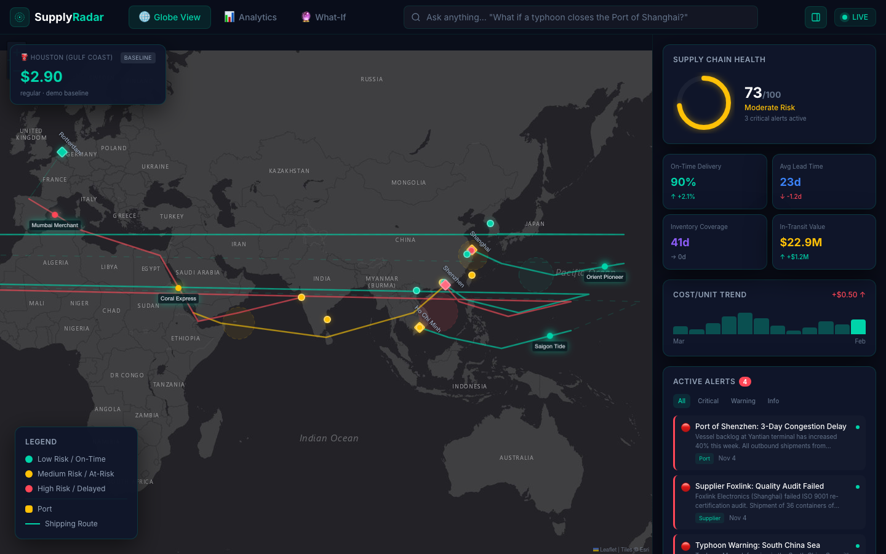

# Supply Radar

A supply chain risk dashboard you can question in plain English. Ask "what if a typhoon closes the Port of Shanghai?" and the map marks the epicenter, lights up the ports and shipments in its path, and estimates what it adds to network risk.

**Live demo:** https://supply-radar.bartlettlabs.io



## What it does

- **Globe View.** Ports, suppliers and in-transit shipments on a world map, colored by risk, next to the KPIs a planner checks first: on-time delivery, lead time, inventory coverage, in-transit value and active alerts.
- **Ask Anything.** Questions go to Claude with the dashboard's data attached. The answer comes back through a tool call with a fixed schema, so a what-if question returns a map overlay (epicenter, affected port and shipment ids, risk change) instead of loose prose. Ids the model invents are dropped before they reach the map.
- **What-If.** Prebuilt disruption scenarios with delayed shipments, revenue at risk, recovery time and added cost, plus before and after lead time, on-time rate and cost per unit.
- **Analytics.** Cost breakdown, lead time trends, disruption history and risk forecasts.
- **Local fuel impact.** The current Houston Gulf Coast retail gas price from the EIA API, and a rough estimate of how a scenario would move it. The estimate comes from a simple rules model and is labeled as an estimate, not a forecast.

## Built to run in public

- **Works without keys.** With no Anthropic key, Ask Anything falls back to a deterministic answer engine over the same data. With no EIA key, the fuel panel uses a fixed baseline and says so.
- **Rate limited.** The public `/api/ask` endpoint allows 20 requests a minute per IP, read from Cloudflare's `cf-connecting-ip` header, to cap token spend.
- **No pinned model version.** The server picks the newest stable Claude Haiku from Anthropic's model list at runtime, so upgrades need no code change. `ANTHROPIC_MODEL` overrides it.
- **Demo data stays current.** Every company, vessel and number is made up, and all dates are anchored to the day you load the page.

## Stack

Next.js 16 (App Router), React 19, TypeScript, Tailwind CSS 4, Leaflet with Esri Dark Gray tiles, Recharts, Framer Motion, the Anthropic TypeScript SDK and the EIA v2 API. Self-hosted with Coolify behind Cloudflare.

## Run it locally

```bash
npm install
npm run dev
```

Open http://localhost:3000. Optional environment variables:

| Variable | Effect |
|---|---|
| `ANTHROPIC_API_KEY` | Turns on Claude answers for Ask Anything |
| `ANTHROPIC_MODEL` | Pins a specific model instead of the newest Haiku |
| `ANTHROPIC_WORKSPACE_ID` | Sends requests under one Anthropic workspace |
| `EIA_API_KEY` | Live weekly gas prices instead of the fixed baseline |

## Why I built it

I spent more than 15 years in demand and supply planning before I started building AI tools. Most risk dashboards make you hunt for the answer. This one lets a planner ask the question they'd ask a colleague and see the answer on the map.

Built by [Kyle Bartlett](https://bartlettlabs.io).
